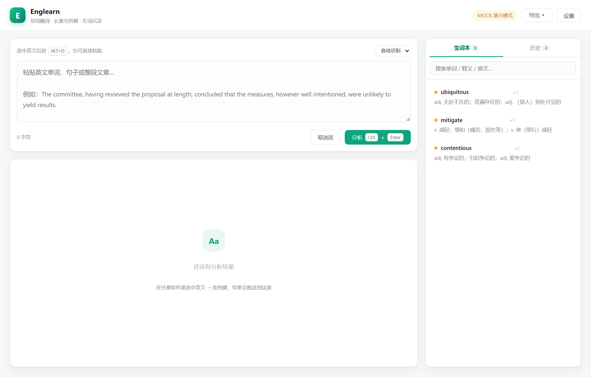

# Englearn · 本地英语精读助手

<!-- 发布到 GitHub 后，把下面的 OWNER/REPO 换成你的仓库，再取消注释 -->
<!-- [](https://github.com/OWNER/REPO/actions/workflows/ci.yml) -->

[](https://www.python.org/)
[](LICENSE)
[](requirements.txt)
[](docs/DEPLOY.md)

在任意软件里选中英文，光标旁弹出小窗；选「翻译 / 长难句 / 收藏 / 页面」，结果自动沉淀进本地生词本，最后导出成 Markdown。

- **纯本地**：服务只监听 `127.0.0.1`，数据是本地一个 SQLite 文件
- **零依赖**：只用 Python 标准库，不需要 `pip install`、Node 或数据库服务
- **可导出**：Markdown / JSON / CSV / Anki TXT / HTML，随时带走自己的学习数据



## 功能

| 功能 | 说明 |
| --- | --- |
| 划词悬浮窗 | 鼠标选中英文后光标旁弹出小窗，可选「翻译 / 长难句 / 收藏 / 页面」 |
| 全局热键取词 | 默认 `Alt+D`，被占用时自动换成可用组合 |
| 剪贴板兜底 | 手动 `Ctrl+C` 也能触发（设置里开关） |
| 词汇卡片 | 音标（英/美）、释义、熟词生义、短语搭配、例句、派生词、类似词，七项齐全 |
| 长难句拆解 | 主干 → 逐层从句 → 修饰成分 → 难点词汇，彩色标签分层 |
| 生词本 | 一键收藏、自动去重计数、三档掌握状态、整页详情与备注 |
| 长难句回看 | 独立标签页管理收藏句子，点开即整页解析 |
| 句子标记 | 在句子里选中词标为陌生词，句内高亮；点高亮词生成词汇卡片 |
| 日历复习 | 按日期查看当天新增生词、收藏句子与分析记录 |
| 历史记录 | 每次分析落库，可搜索、回看、删除 |
| 多格式导出 | Markdown / JSON / CSV / Anki TXT / HTML |
| 开机自启 | 注册表启动项，登录后静默启动并打开页面 |

## 平台支持

| 平台 | 网页界面 | 划词悬浮窗 / 全局热键 | 状态 |
| --- | :---: | :---: | --- |
| Windows 10 / 11 | ✅ | ✅ | 已验证 |
| Linux | ✅ | ❌ | 未实测 |
| macOS | ✅ | ❌ | 未实测 |
| Docker | ✅ | ❌ | 已验证（构建 + 启动 + 分析） |

> 悬浮窗、全局热键、模拟复制依赖 Win32 API，仅 Windows 可用；其他平台是「浏览器 + 粘贴」的网页版。

## 快速开始

| 方式 | 命令 | 适用 |
| --- | --- | --- |
| Windows（推荐） | 双击 `start.cmd` | 完整功能 |
| Linux / macOS | `./run.sh` | 网页模式 |
| Docker | `docker compose up -d` | 服务器 / 隔离环境 |

首次启动后打开 <http://127.0.0.1:8765>，点右上角 **设置** 填入 API Key（默认对接 DeepSeek，兼容任意 OpenAI 协议服务）。
没有 Key 时可在设置里勾选「Mock 演示模式」先体验界面。

完整步骤、配置项、故障排查见 **[部署指南](docs/DEPLOY.md)**。

## 验证安装

不用 Key、不花钱，一条命令验证部署是否正常：

```bash
python scripts/selftest.py
```

它会自己拉起一个 mock 服务，跑完 11 项检查（健康检查、页面、词汇卡片字段、长难句结构、收藏、标记、日历、五种导出）后自动关闭。

## 文档

| 文档 | 内容 |
| --- | --- |
| [docs/DEPLOY.md](docs/DEPLOY.md) | 三种部署方式、配置项、验证清单、故障排查、卸载 |
| [docs/RELEASE.md](docs/RELEASE.md) | 版本规范、发布流程、许可证说明、CI 建议 |
| [CHANGELOG.md](CHANGELOG.md) | 版本变更记录 |
| [docs/Englearn-使用教程.pdf](docs/Englearn-使用教程.pdf) | 图文教程（含界面截图） |

## 项目结构

```text
Englearn/
├─ app.py                入口：HTTP 服务 + 热键 + 悬浮窗调度
├─ core/                 纯逻辑模块
│  ├─ config.py          配置读写
│  ├─ store.py           SQLite 存储
│  ├─ llm.py             OpenAI 兼容调用
│  ├─ analyze.py         分类 / 提示词 / 结果归一化 / mock
│  ├─ capture.py         Win32 热键与剪贴板
│  ├─ mousehook.py       全局鼠标钩子
│  ├─ popup.py           悬浮操作窗（Tkinter）
│  ├─ autostart.py       开机自启
│  └─ export.py          五种导出格式
├─ web/                  前端（原生 HTML/CSS/JS，无构建步骤）
├─ scripts/              测试、截图、文档生成、自启入口
├─ docs/                 部署 / 发布 / 教程文档
├─ start.cmd             Windows 启动
├─ run.sh                Linux / macOS 启动
├─ Dockerfile           网页模式镜像
└─ docker-compose.yml   单服务编排
```

运行期产物（`data/`、`exports/`、`logs/`、`config.json`）已被 `.gitignore` 忽略。

## 配置

配置写在 `config.json`（首次启动自动生成），字段说明见 [部署指南 · 配置项](docs/DEPLOY.md#5-配置项)。

安全提示：**`config.json` 里是明文 API Key**，已被 `.gitignore` 忽略；不要提交，也不要随截图外发。

## 开发

```bash
# 运行时零依赖，仅需 Python 3.10+
python -m py_compile app.py core/*.py     # 语法检查
python scripts/selftest.py                # 冒烟测试
python app.py --mock --no-open --no-hotkey --no-popup   # 无界面调试
```

前端没有构建步骤，改完 `web/` 下的文件刷新页面即可。
开发/文档相关依赖（Pillow、python-docx 等）见 `requirements-dev.txt`，普通使用不需要安装。

## 已知限制

- 悬浮窗 / 全局热键 / 模拟取词仅 Windows
- **无登录鉴权**，切勿把端口暴露到公网
- 取词会临时占用剪贴板，结束后只还原文本
- 模型调用为一次性返回，暂未支持流式输出

## 许可证

[MIT](LICENSE)
